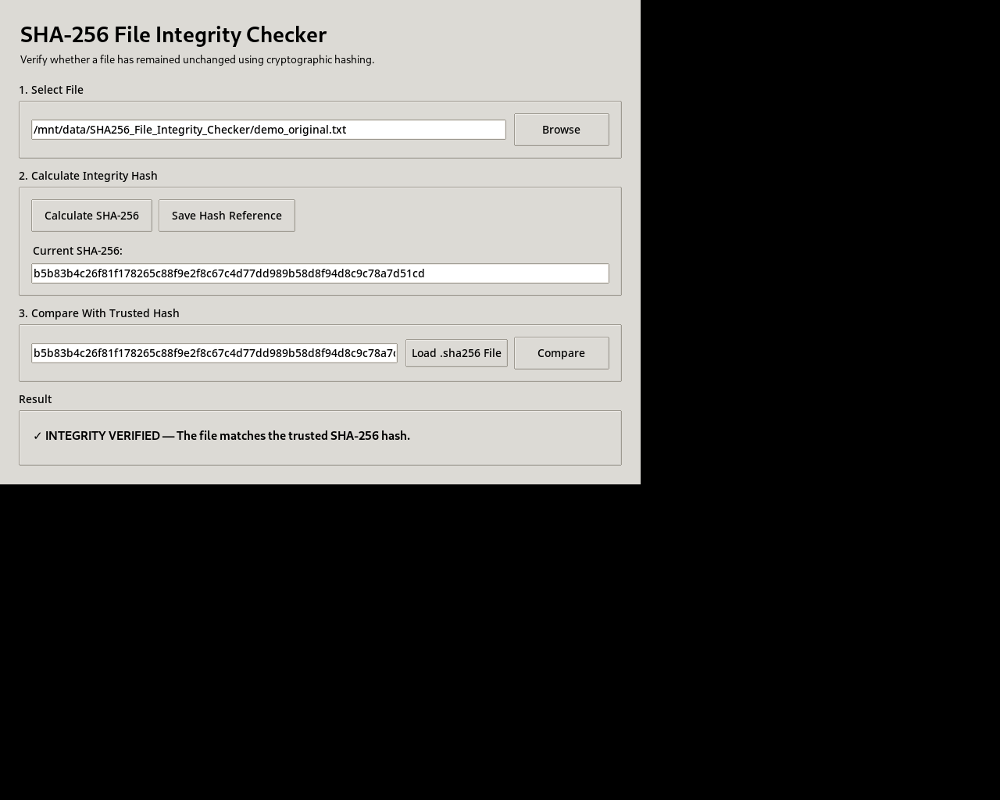

# SHA-256 File Integrity Checker

A Python + Tkinter Cyber and Network Security (CNS) mini-project that uses the **SHA-256 cryptographic hash function** to verify whether a file has been modified.

## 1. Project Title

**SHA-256 File/Data Integrity Checker**

## 2. Problem Statement

Files can be accidentally or maliciously modified during storage, transfer, or handling. A simple way to detect modification is to calculate a cryptographic hash of the original file and compare it with the hash calculated later.

This project implements a user-friendly Python application that calculates a file's SHA-256 digest and compares it with a trusted reference digest. A mismatch indicates that the file content is no longer identical to the trusted version.

## 3. Objectives

- Understand cryptographic hashing.
- Implement SHA-256 using Python's `hashlib`.
- Verify file integrity through hash comparison.
- Demonstrate the difference between hashing and encryption.
- Apply input validation and secure file-handling practices.
- Provide a simple GUI for non-technical users.
- Produce a reusable `.sha256` reference file.

## 4. Technologies Used

- Python 3
- Tkinter
- SHA-256
- Windows/Linux/macOS compatible Python runtime

## 5. Python Libraries Used

- `hashlib` — SHA-256 cryptographic hashing
- `tkinter` — graphical user interface
- `pathlib` — safe and convenient file-path handling
- `re` — SHA-256 input validation

All libraries are part of the Python standard library. No third-party package is required.

## 6. Cryptography / Network Security Concepts Used

### Cryptographic Hashing
SHA-256 converts arbitrary file data into a fixed 256-bit (64 hexadecimal character) digest.

### Data Integrity
If even a small part of a file changes, its SHA-256 digest will normally change, allowing the application to detect a mismatch.

### Collision Resistance
SHA-256 is designed so that finding two different inputs with the same digest is computationally infeasible for practical purposes.

### Integrity Verification
The application compares:
`Trusted SHA-256 == Current SHA-256`

If equal, the file content matches the trusted reference. If different, a modification is detected or the wrong reference was supplied.

### Security Limitation
SHA-256 does not prove who created a file. A malicious person who can replace both the file and its reference hash could make a new matching pair. For authenticity, a digital signature or authenticated integrity mechanism is more appropriate.

## 7. Key Features

- File selection through GUI
- SHA-256 calculation
- Chunk-based hashing for lower memory usage
- 500 MB configurable safety limit
- SHA-256 format validation
- Save trusted hash as `.sha256`
- Load an existing `.sha256` reference
- Compare current and trusted hashes
- Clear success/failure result
- File is read only; the application never executes or modifies the selected file
- User-friendly error messages

## 8. System Requirements

### Hardware
- 4 GB RAM or more recommended
- Any modern processor
- At least 100 MB free disk space

### Software
- Python 3.9 or newer
- Windows, Linux, or macOS
- Tkinter support

## 9. Project Structure

```text
SHA256_File_Integrity_Checker/
│
├── main.py
├── README.md
├── requirements.txt
├── .gitignore
├── LICENSE
├── screenshots/
└── tests/
    └── test_hashing.py
```

## 10. How to Install and Run

### Step 1: Install Python

Install Python 3 from the official Python website and verify:

```bash
python --version
```

### Step 2: Clone the repository

```bash
git clone YOUR_GITHUB_REPOSITORY_URL
cd SHA256_File_Integrity_Checker
```

### Step 3: Install dependencies

No third-party packages are required.

```bash
pip install -r requirements.txt
```

### Step 4: Run

```bash
python main.py
```

## 11. How to Use

1. Click **Browse** and select a file.
2. Click **Calculate SHA-256**.
3. Save the digest using **Save Hash Reference**.
4. Later, select the same file again.
5. Load the trusted `.sha256` file or paste the trusted 64-character hash.
6. Click **Compare**.
7. The application displays:
   - **Integrity Verified** if hashes match.
   - **Integrity Check Failed** if hashes differ.

## 12. Example

Suppose the original file produces:

```text
SHA-256:
abc123...<64 hexadecimal characters>...
```

After modification, the same file produces a different digest.

```text
Trusted Hash  = H1
Current Hash  = H2

H1 == H2  → Integrity Verified
H1 != H2  → Modification Detected
```

## 13. Screenshots

The project includes demonstration screenshots:





## 14. Project Demonstration

The repository includes these demo files:
- `demo_original.txt` — original test file
- `demo_original.txt.sha256` — trusted SHA-256 reference
- `demo_modified.txt` — modified version used to demonstrate detection

The original file produces:
```text
b5b83b4c26f81f178265c88f9e2f8c67c4d77dd989b58d8f94d8c9c78a7d51cd
```

The modified file produces:
```text
5e703e65fea93dc246ef172ac42709e8b97bb0d77efe8d243b484b180783fbbe
```


### Demonstration 1 — Original File

- Select a test file.
- Calculate SHA-256.
- Save the reference hash.
- Compare the file with the saved hash.
- Result: **Integrity Verified**.

### Demonstration 2 — Modified File

- Change the contents of the test file.
- Calculate SHA-256 again.
- Compare against the old trusted hash.
- Result: **Integrity Check Failed**.

This demonstrates that cryptographic hashing can be used to detect data modification.

## 15. Testing

| Test Case | Input | Expected Result |
|---|---|---|
| TC01 | Valid text file | SHA-256 generated |
| TC02 | Same file + same reference | Integrity Verified |
| TC03 | Modified file + old reference | Integrity Check Failed |
| TC04 | Empty file | Valid SHA-256 generated |
| TC05 | Invalid hash | Validation error |
| TC06 | No file selected | Warning shown |
| TC07 | Unsupported/unreadable path | Error shown |
| TC08 | File above safety limit | File rejected |

## 16. Basic Security Considerations

- Input hash is restricted to exactly 64 hexadecimal characters.
- Files are opened in binary read-only mode.
- Files are never executed by the application.
- Hashing is performed in chunks.
- A configurable maximum file size limits resource consumption.
- The application does not store the original file contents.
- The reference hash must be obtained from a trusted source.

## 17. Future Scope

- Drag-and-drop support
- Folder integrity scanning
- Batch verification of multiple files
- Recursive directory hashing
- Digital signature verification
- HMAC-based integrity/authentication
- Tamper-evident audit logs
- Optional Flask/Streamlit web interface

## 18. Project Demonstration / Live Demo

For a local desktop application, a public live demo is not required. If your faculty specifically requires a live link, deploy a Flask/Streamlit version separately.

## 19. GitHub Repository Link

**To be added after repository creation:**

`YOUR_GITHUB_REPOSITORY_URL`

## 20. Conclusion

The project demonstrates a practical Cyber Security concept using SHA-256 cryptographic hashing. It provides a simple method to calculate and compare file digests so that changes to file content can be detected. The project also demonstrates secure input validation and safe file handling while clearly showing that hashing is used for integrity verification rather than encryption.
